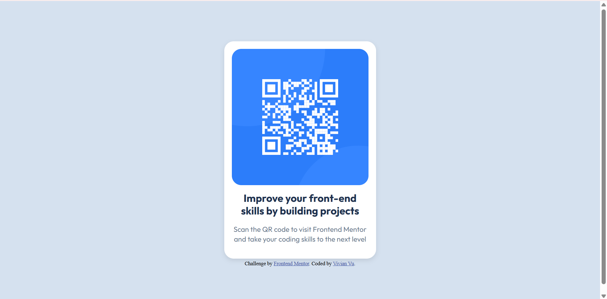

# Frontend Mentor - QR code component solution

This is a solution to the [QR code component challenge on Frontend Mentor](https://www.frontendmentor.io/challenges/qr-code-component-iux_sIO_H). Frontend Mentor challenges help you improve your coding skills by building realistic projects. 

## Table of contents

- [Overview](#overview)
  - [Screenshot](#screenshot)
  - [Links](#links)
- [My process](#my-process)
  - [Built with](#built-with)
  - [What I learned](#what-i-learned)
  - [Continued development](#continued-development)
  - [AI Collaboration](#ai-collaboration)
- [Author](#author)

## Overview

This is my solution for the QR code component project for frontend mentor.

### Screenshot

### Links

- Solution URL: (https://github.com/viveevu11/qrcode-component)
- Live Site URL: (https://qrcode-component-zeta.vercel.app/)

## My process

I started off looking over the provided html to understand the initial structure of the project. I then added the necessary divs to make a card for the qr code to go. I then styled with css. 

### Built with

- Semantic HTML5 markup
- CSS custom properties
- Flexbox
- Mobile-first workflow

### What I learned

Through this project, I learned that the body tag doesnt span the entire web page at first, it only grows to the content height. I found this out when I tried to center the card in the middle of the page using flexbox ans saw that it was sticking more towards the top of the page. I found that I have to set it's min-height to 100vh which is the full height of the web browser. 

### Continued development

I want to continue focusing on making responsive layouts and understanding how different elements within the webpage interact with one another. 

### AI Collaboration

I used Copilot in VS Code for this project. It was extremely helpful in explaining format issues I was confused about. 

## Author

- Website - [Vivian Vu]
- Frontend Mentor - [@viveevu11](https://www.frontendmentor.io/profile/viveevu11)

